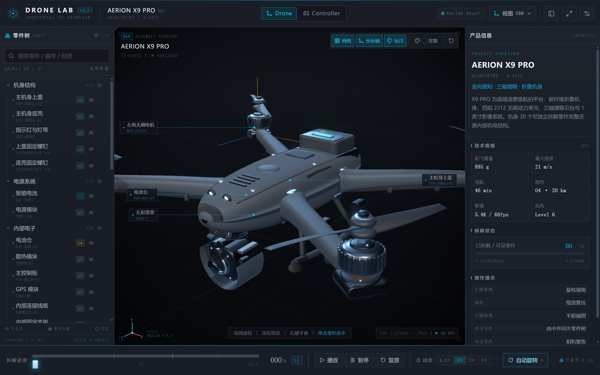
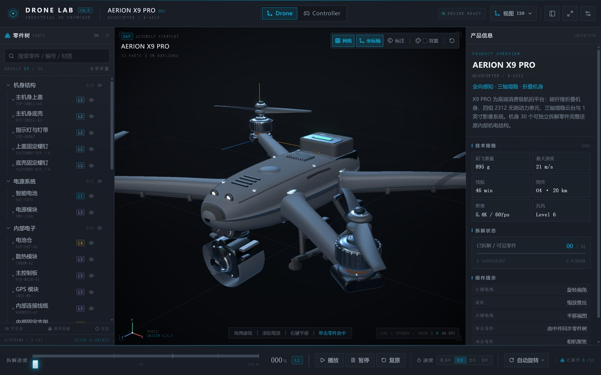
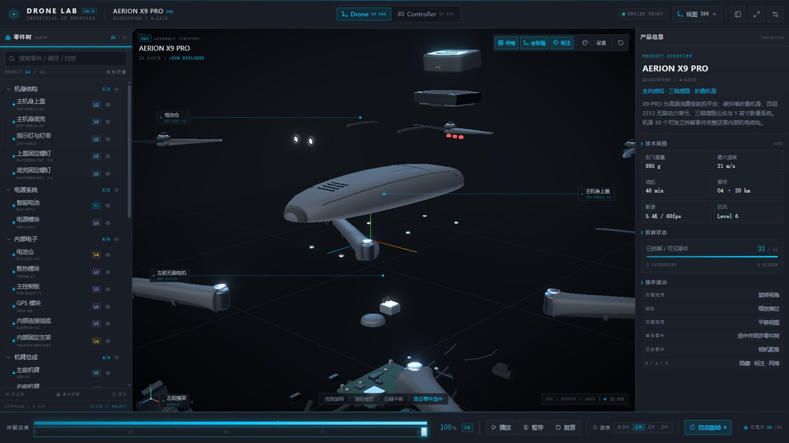
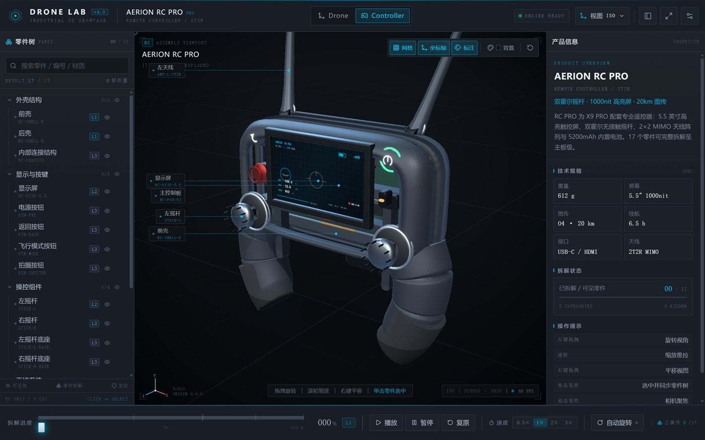
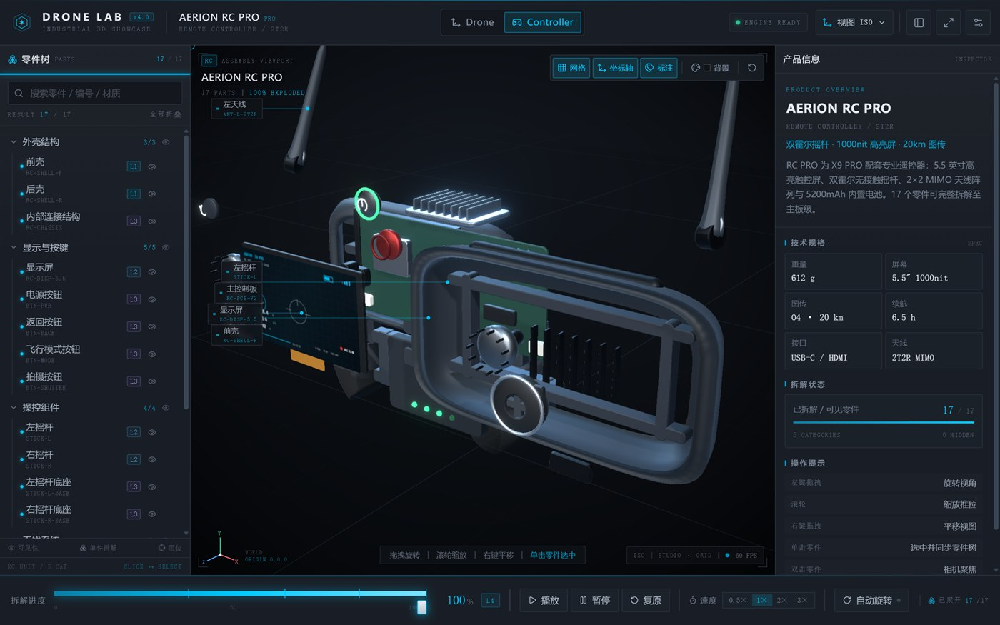

# AERION 3D · 无人机与遥控器可拆解展示系统

工业级产品展示级 Web 3D 应用。**全部模型由 Three.js 参数化几何实时生成**，无任何外部 glTF/CAD 资源，33 个无人机零件 + 17 个遥控器零件均为独立 `Mesh`/`Group`，支持整体 / 分级 / 单件拆解。



| 无人机 · 装配态 | 无人机 · 拆解态 |
|---|---|
|  |  |

| 遥控器 · 装配态 | 遥控器 · 拆解态 |
|---|---|
|  |  |

---

## 1. 运行方式

```bash
cd 2026_11_17_19-45-15
npm install          # 已安装完成，可跳过
npm run dev          # 开发模式 → http://127.0.0.1:5273
npm run build        # 类型检查 + 生产构建 → dist/
npm run preview      # 预览生产包 → http://127.0.0.1:4173
```

当前会话已启动：

| 服务 | 地址 | 说明 |
|---|---|---|
| Vite Dev | http://127.0.0.1:5273 | 热更新开发版 |
| Vite Preview | http://127.0.0.1:4173 | 生产构建（验收测试跑在此地址） |

自动化验收：

```bash
node scripts/verify.mjs             # 视觉截图（5 张）
node scripts/test-interactions.mjs  # 20 项交互断言，退出码 0 = 全部通过
node scripts/render-shots.mjs       # 1600×1000 展示截图
```

---

## 2. 技术栈（实际安装版本）

| 依赖 | 版本 |
|---|---|
| react / react-dom | 19.3 |
| three | 0.187 |
| @react-three/fiber | 9.8 |
| @react-three/drei | 10.7 |
| @react-three/postprocessing + postprocessing | 3.2 / 6.39 |
| gsap | 3.15 |
| zustand | 5.1 |
| tailwindcss | 3.4.17 |
| vite / typescript | 8.3 / 5.9 |
| lucide-react | 1.74 |

---

## 3. 目录结构

```
src/
├─ App.tsx                    仅做布局编排，不含业务逻辑
├─ components/
│  ├─ layout/   TopBar · LeftPanel · RightPanel · BottomBar · ViewportOverlay
│  ├─ panels/   PartTree · PartInfo · SettingsPanel · HelpOverlay
│  └─ ui/       Button / Toggle / LevelBadge 等原子组件
├─ three/
│  ├─ scene/    ShowcaseScene（Canvas、灯光、IBL、后处理、相机机位）
│  ├─ core/     PartRegistry（零件对象注册表，供相机聚焦）
│  ├─ materials/palette.ts（PBR 材质库 + 程序化 HUD 贴图）
│  ├─ models/
│  │  ├─ shared/  geometry.ts（参数化几何库）· Part.tsx（拆解容器）
│  │  ├─ drone/   config · geometries · Body · Arms · Gimbal · Internals · Sensors · DroneModel
│  │  └─ controller/ config · geometries · Shell · Controls · Internals · ControllerModel
│  ├─ animations/explode.ts（序列动画、全局暂停）
│  └─ interactions/ → 由 shared/Part.tsx 承担射线交互
├─ store/useAppStore.ts       Zustand 单一状态源
├─ data/                      droneParts.ts(30) · controllerParts.ts(17)
├─ hooks/useExplodeActions.ts 拆解动作统一入口
├─ types/ · utils/
```

数据与渲染完全解耦：`data/*.ts` 只描述零件元数据（ID / 名称 / 分类 / 层级 / 介绍 / 材质 / 尺寸 / 爆炸向量），`three/models/**` 只负责几何，`Part.tsx` 把两者按 `id` 绑定。

---

## 4. 建模方法（非 Box 拼接）

`src/three/models/shared/geometry.ts` 实现了一套参数化几何库，模型全部由它生成：

| 函数 | 用途 | 应用零件 |
|---|---|---|
| `buildLoft` | 超椭圆截面沿 Z 放样 | 遥控器机身、电机钟形壳过渡 |
| `buildHalfLoft` | 上半/下半壳放样（含剖面封盖） | 无人机上盖、底壳 |
| `buildShell` | 带壁厚开放壳体（外壳 + 内腔 + 翻边） | 遥控器前壳 / 后壳（拆解后可见内腔与加强筋） |
| `sweepProfile` | 沿曲线扫掠自定义截面（固定 side/up 参考系） | 折叠机臂、手柄、云台保护罩 |
| `sweptTube` | 变径圆管 | 起落架、线缆、缝线 |
| `propellerBladeGeometry` | 展向变弦长 + 变桨距的翼型截面放样 | 8 片桨叶（桨根 36° → 桨尖 11°） |
| `chamferBox` / `flatPlate` / `frameBox` | 圆角 + 斜切挤出（`ExtrudeGeometry`） | 电池、屏幕、按键、PCB、散热鳍片 |
| `lathe` | 旋成体（`LatheGeometry`） | 电机、镜头筒、摇杆帽、GPS 罩、脚垫 |
| `radialFins` / `mergeGeometries` | 圆周鳍片与几何合并 | 电机散热筋、线缆束 |

所有闭合网格经 `fixWinding()` 用有符号体积校正绕序，法线一律朝外。

材质：12 组 PBR 预设（石墨灰涂装、银灰阳极氧化、镜面铬、磨砂橡胶、碳纤维、PCB 阻焊、铜绕组、镀金触点、铝鳍片、光学玻璃…），配 `Environment` 程序化 studio IBL（4 组 Lightformer，256² 立方图，离线生成无外部依赖）。

渲染管线：ACESFilmic ToneMapping → SSAO → Bloom → SMAA → Vignette，阴影 PCFSoft 2048²，`dpr=[1,1.8]`，ContactShadows 实时接地阴影。

---

## 5. 零件清单

**无人机（30）**：主机身上盖 / 底壳 / 指示灯灯带 · 左前·右前·左后·右后机臂 · 四组无刷电机 · 四组双叶螺旋桨 · 云台保护罩 · 三轴云台结构 · 摄像头外壳 · 摄像头镜头 · 智能电池 · 电池仓 · 左·右起落架 · 前置视觉传感器 · 后置视觉传感器 · 散热模块 · 主控制板 · GPS 模块 · 电源模块 · 内部连接线缆

**遥控器（17）**：前壳（含双手柄）/ 后壳 · 显示屏 · 左·右摇杆 · 左·右摇杆底座 · 电源按钮 · 返回按钮 · 飞行模式按钮 · 拍摄按钮 · 左·右天线 · 主控制板 · 电池 · 散热模块 · 内部连接结构

每个零件含：独立 ID、中文名、工程编号、分类、拆解层级（L1 外壳 / L2 总成 / L3 元件）、介绍文案、材质列表、尺寸标注、爆炸位移向量（部分含爆炸旋转）。

---

## 6. 拆解系统实现

- **状态模型**：`exploded: Record<partId, boolean>` 为唯一目标态；`distance` 为距离系数（0.35–2.0×）；每个 `Part` 内部维护一个 GSAP 补间对象 `{v: 0→1}`，`onUpdate` 把 `explodeVector × v × distance` 写入外层 group，内层 group 保留原始装配变换 —— 因此复原后姿态与初始 100% 一致，且距离滑块改动即时生效。
- **多级**：按零件 `level` 过滤，一级 13 件 / 二级 25 件 / 三级 30 件。
- **自动播放**：`gsap.timeline` 驱动一条 0→1 的代理补间，按层级由外到内依次点亮零件，可被全局暂停打断。
- **暂停 / 继续**：`gsap.globalTimeline.pause()/resume()`，拆解、序列、相机补间统一冻结；暂停态下用户再点任意拆解按钮会自动恢复，避免"点了没反应"。
- **单件**：零件树右侧方块按钮、右侧详情面板按钮、双击模型聚焦三种入口，状态同源。
- **自动取景**：拆解比例变化时相机沿当前视line自动推拉（距离 × (1 + 0.34 × 拆解率)），保证爆炸后的零件不越出取景；手动缩放不会被强行改回。默认距离系数 0.86，最高可推到 2.0×。

拆解方向按零件实际装配关系标定（上盖 +Y、电池 +Y/上抽、机臂径向、桨叶 +Y 并旋转 45°、云台向下-前、天线外翻），并逐项检查过不相交。

---

## 7. 交互

| 操作 | 行为 |
|---|---|
| 左键拖拽 / 滚轮 / 右键拖拽 | 旋转 / 缩放 / 平移（OrbitControls，带阻尼） |
| 单击零件 | 选中 + 青色自发光高亮 + 右侧详情 |
| 双击零件 | 相机 GSAP 聚焦该零件 |
| 悬停零件 | 浅色高亮 + 跟随鼠标的零件标签 |
| 零件树单击 / 方块按钮 | 选中并高亮 / 单件拆解复原 |
| 顶部 | 模型切换 · 重置视角 · 操作说明 · 设置 · 全屏 · 侧栏开关 · RESET |
| 底部 | 进度条 · 距离滑块 · 复原/一级/二级/三级 · 自动播放 · 暂停 · 整体拆解 · 复原 |
| 键盘 | `R` 重置视角 · `E` 整体拆解 · `Space` 暂停/继续 · `Esc` 取消选中 |

设置面板：自动旋转、螺旋桨旋转、实时接触阴影、动画时长（0.25–2s）、暂停/继续、重置视角，并显示当前渲染管线参数。

---

## 8. 验收结果

`node scripts/test-interactions.mjs` 对**生产构建**（:4173）逐项断言，**20 / 20 全部通过**：

| # | 验收项 | 结果 |
|---|---|---|
| 1 | 无人机完整显示，30 零件 | PASS |
| 2 | 零件树点击 → 右侧详情联动 | PASS |
| 3 | 单件拆解进度 +1 | PASS |
| 4 | 单件复原 | PASS |
| 5 | 多级拆解（二级 25/30） | PASS |
| 6 | 拆解距离滑块（0.35–2.0×） | PASS |
| 7 | 一键整体拆解 30/30 | PASS |
| 8 | 一键复原 0/30 | PASS |
| 9 | 自动播放按序拆解 | PASS |
| 10 | 自动播放按钮态切换 | PASS |
| 11 | 暂停 → 进度冻结（11→11） | PASS |
| 12 | 继续 → 进度恢复推进（11→12） | PASS |
| 13 | 射线拾取点击 3D 零件选中 | PASS |
| 14 | 搜索过滤（"桨" → 4/30） | PASS |
| 15 | 切换遥控器（17 零件） | PASS |
| 16 | 遥控器整体拆解 17/17 | PASS |
| 17 | 设置面板与开关 | PASS |
| 18 | 帮助面板 | PASS |
| 19 | 渲染循环运行（FPS 面板） | PASS |
| 20 | 无控制台错误（0 error / 0 pageerror） | PASS |

截图（`test-output/final/`）：`1-drone.png`、`2-drone-exploded.png`、`3-controller.png`、`4-controller-exploded.png`、`5-selected.png`。

控制台仅剩两条 three 内部警告（`THREE.Clock` 弃用、`PCFSoftShadowMap` 在 r187 被合并为 PCF），非本项目代码引起，不影响功能。

---

## 9. 未完成 / 已知限制

1. **无物理碰撞的拆解路径**：爆炸向量为手工标定，未做路径规划和碰撞检测；修改几何后需重新校对向量。
2. **螺旋桨为恒定角速度旋转**，无气动/升力模型，也未反驱机身。
3. **未引入 CAD/glTF 资产**：全部程序化建模，细节密度低于工业级 CAD 转网格（螺丝、卡扣、丝印为示意级）。
4. **性能未做 LOD**：单场景约 260 个 mesh、~130k 三角面，后处理（SSAO+Bloom）在集成显卡上可能掉到 30fps 以下；软件渲染（SwiftShader）下仅 3–6 fps（验收测试因此使用轮询而非固定等待）。
5. **未做代码分块**：单 JS chunk 1.6MB（gzip 486KB），未按需拆包。
6. **移动端**：< 1180px 自动收起两侧面板，但未针对触屏手势与竖屏做专门布局。
7. **未做导出**：无截图/GLTF 导出按钮（未放置不可用的装饰性按钮是本项目的硬约束）。


---

## 10. 第二轮：无人机模型工业设计级精细化

> 本轮只改无人机模型与材质，架构、拆解系统、交互逻辑保持不变。

### 10.1 几何升级

| 部位 | 做法 |
|---|---|
| 机身 | 19 个超椭圆站位 × 56 环向分段放样（原 11×36）；机头 3 段圆弧收口，上盖与底壳以 0.505 分割面连续过渡 |
| 机臂 | `sweepProfileFn` 逐段变截面扫掠：根部指数衰减整流包边（1+0.28·e^-18t），展向 37.5×29.5 → 25×20 mm，超椭圆指数 3.5→2.7 |
| 桨叶 | 新 `propellerBladeGeometry`：NACA 四位翼型（半厚 = 5t·(0.2969√x−0.126x−0.3516x²+0.2843x³−0.1015x⁴)）、中弧线 `4c·x(1−x)`、展向变弦长（中段 +16% 鼓起）、桨距 37°→11° 幂次扭转、桨尖 8% 展向收圆 |
| 螺丝 | `screwSet()` 批量生成沉头内六角螺钉（头 + 六角槽两段几何，可翻转朝下），上盖 6 + 底壳 4 + 散热器 4 + 电机座 16 + 顶盖 12 |
| 接缝 | `bodyTopY()/bodyBottomY()` 对超椭圆截面求交，把缝线精确铺在曲面上（1.15mm 深色嵌条） |
| 通风格栅 | 前部进气百叶 4 片（沿曲面倾斜 0.2rad）、两侧散热百叶 10 片、底部排热槽 6 条 |
| 云台 | Yaw（绕 Y）→ Roll（绕 Z）→ Pitch（绕 X）三级嵌套 `group`，三个轴各有定子/转子/壳体；镜头改为凸面光学件（lathe 旋成）+ 镀膜环 |
| 电池 | 金属顶板 + CanvasTexture 丝印（品牌/容量/电压/能量/温度范围/序列号/信息矩阵）+ 凹槽电量窗与 4 段灯 + 侧向释放卡扣 + 6 针电源接口 + 拉带 |
| 视觉传感 | 由埋入式改为机腹吊舱：阳极镜圈 + 深色镜片 + 双 IR 补光 + 屏蔽罩 + 安装支架 |

### 10.2 材质升级（10 → 18 组）

新增 `mattePlastic`（哑光工程塑料 r0.78）、`mattePlasticDark`、`anodized`/`anodizedDark`（阳极氧化铝 m1.0 r0.30）、`screwMetal`（金属螺钉 r0.20）、`rubberSoft`（黑色软胶 r0.94）、`diffuserGlass`（半透明灯罩）、`lensGlass`（光学玻璃 transmission 0.95）。

### 10.3 运动与层级

- 四个电机各自持有独立的 `rotor` group，按 `c.spin` 方向以 5.2 rad/s 旋转，与对应螺旋桨同向；顺/逆时针成对相反。
- 云台三轴为真实父子链：`gimbal-yaw-axis` → `gimbal-roll-axis` → `gimbal-pitch-axis`，相机外壳/镜头/保护罩以相同姿态嵌套，保证拆解后仍对位。

### 10.4 回归验证

| 项目 | 结果 |
|---|---|
| 拆解 / 复原 / 分级 / 单件 | 20/20 通过（生产构建 :4173） |
| 点击选择 / 射线拾取 / 搜索 | 通过 |
| 四电机独立旋转 | FL +22.15°、FR −22.15°、RL −22.15°、RR +22.15°（2s 增量） |
| 控制台错误 | 0 |
| 场景规模 | 265 Mesh / 262,622 三角面 / 147 几何体 |

对比页：`test-output/compare.html`；零件特写：`test-output/detail/`。

### 10.5 本轮未做

- 机臂仍为整体扫掠实体，未做"上下壳分件"（拆解层级仍是单件机臂）。
- 云台三轴为静态姿态（yaw −4.3°、roll 2°、pitch −6.6°），没有接入实时增稳动画。
- 螺丝为几何头 + 六角槽，未做螺纹。
- 无人机当前 262,622 三角面（265 Mesh），未做 LOD；低端 GPU 建议在设置中关闭接触阴影。


---

## 11. 第三轮：专业级爆炸拆解系统（Exploded View）

### 11.1 四级拆解层级

| 层级 | 名称 | 零件 | 全局进度区段 |
|---|---|---|---|
| L1 | 外部附件 | 4 螺旋桨 · 云台保护罩 · 智能电池 · 左右起落架（8） | `0.00 – 0.36` |
| L2 | 外部机身 | 上壳 · 下壳 · 4 机臂 · 4 电机 · 灯带 · 上/底壳螺钉组（12） | `0.10 – 0.62` |
| L3 | 内部组件 | 主控制板 · GPS · 电源模块 · 散热模块 · 内部线缆（5） | `0.40 – 0.82` |
| L4 | 精密组件 | 云台三轴 · 摄像头外壳 · 镜头 · 前后视觉传感器 · 电池仓 · 内部固定支架（8） | `0.62 – 1.00` |

无人机零件数 30 → **33**：新增「内部固定支架」与「上盖 / 底壳固定螺钉」两个独立零件，螺钉上下各沿安装轴退出。

### 11.2 统一进度模型

```ts
// src/data/motion.ts
LEVEL_BANDS = { 1:[0,0.36], 2:[0.10,0.62], 3:[0.40,0.82], 4:[0.62,1.00] }

start = band[0] + order × (bandSpan − duration)
window = [start, start + duration]        // 每个零件在全局进度上的运动区段
t = clamp((progress − start) / duration)  // 局部进度
t = inOutCubic(t)                         // 缓动
pos = explode × t × distance              // 位移
rot = explodeRot × t                      // 旋转
```

- 全局只有一个 `progress`（store 唯一真值），滑块 / 分级按钮 / 自动播放 / 暂停全部写它；
- 零件位移是 `progress` 的**纯函数**，所以反向拖动、倒放天然成立，不会跳变；
- 层级区段互相重叠（L1 收尾时 L2 已启动），整体连续；
- 位移只写在外层 group，内层保留装配变换 → 复原后 100% 回到原位。

数据结构（`PartDef`）：`originalPosition`（由组件 position 提供）、`explode`（= explodedPosition − originalPosition）、`explodeRot`、`level`、`order`、`duration`。运行时由 `motionById` 预计算成 `{window, offset, rot}`。

### 11.3 运动规则

| 规则 | 实现 |
|---|---|
| 机臂向四周展开 | 每臂沿自身 45° 方向外移 16.5cm，附 7° 翻转 |
| 螺旋桨向上分离 | +19cm/−13cm + 45° 自转 |
| 电池后上方 | +20cm 上 / +11cm 后 / −8° 俯仰 |
| 上机身上 / 下机身下 | ±21cm 对开 |
| 内部电路板逐层展示 | 支架 −7.5cm、主板 +7cm、GPS +16cm、电源 +11cm 侧移、线缆 +20cm 后抽 |
| 云台向前分离 | −15.5cm 前移 + 6° 俯仰；相机壳/镜头再依次前移、侧移 |
| 电机沿机臂方向分离 | 与机臂同向 25cm（FL/FR/RL/RR 各自方向） |
| 螺钉沿安装轴线 | 上盖 6 颗 +11cm（+Y）、底壳 4 颗 −11cm（−Y） |

### 11.4 父子跟随（避免重复位移）

`FOLLOW_MAP`：安装在下壳上的 10 个零件（云台、相机、视觉、支架、主板、GPS、电源、线缆）与安装在上壳的 2 个零件（电池仓、散热器）声明 `follow`。

驱动分两遍：先算各自位移，再叠加**一层**父级位移，父级不再递归 → 不会重复计算；子件自身 `explode` 只表示相对父级的增量。中间态内部件随外壳一起移动，不会悬空。

### 11.5 交互控制

| 控件 | 行为 |
|---|---|
| 拆解比例滑块 0–100% | 直接写 `progress`，实时同步；拖动即中断进行中的补间 |
| 拆解距离 ×0.35–2.00 | 整体位移缩放 |
| 速度 0.5× / 1× / 2× / 3× | 写入补间 `timeScale`，播放中改速立即生效 |
| 单级拆解 一级~四级 | 补间到该层级区段终点（36/62/82/100%） |
| 全部拆解 / 全部复原 | 1.6s / 1.6s 补间到 100% / 0% |
| 自动拆解 / 自动复原 | 6.2s 基准时长的完整演示，可暂停、可反向 |
| 暂停 / 继续 | `tween.pause()/resume()`，进度冻结 |
| 单件拆解 | 独立 `boost` 值（0.85s 缓动），与全局进度取 max，不影响其他零件 |

### 11.6 测试结果（生产构建 :4173）

`node scripts/test-explode.mjs` → **24/24 通过**：

起止位姿、滑块 45% 中间插值、100% 全件脱离、33/33 在视锥内、反向连续单调、四级定档 36/62/82/100%、全部拆解/复原、自动复原、暂停冻结、继续推进、速度 timeScale、单件拆解不改全局进度、射线拾取、切模型复位、0 控制台错误。

可见性审计 `__audit()`：0% 与 100% 均 33/33 可见、0 越界。

过程可视化：`test-output/stages/index.html`（0/25/50/75/100% 五帧实拍）。

### 11.7 本轮未做

- 零件仍无真实碰撞检测，拆解路径是手工标定的方向 + 距离；改动几何后需重新校对。
- 单级拆解是「拆到第 N 级」，不是「只拆第 N 级」。
- 螺钉为整组零件（6 颗 / 4 颗一起沿轴移动），未做到单颗独立拆解。

---

## 12. 第四轮：升级为工业产品展示平台 UI

### 12.1 视觉系统

| 令牌 | 值 | 用途 |
|---|---|---|
| `--c-bg` | `#101318` | 页面背景 |
| `--c-panel` | `#191E26` | 面板 / 顶栏 / 底栏 |
| `--c-primary` | `#00C8FF` | 主色：选中、进度、标注引线、自动旋转 |
| `--c-muted` | `#8593A5` | 辅助色：次级文字、图标 |
| `--c-text` | `#E8EDF4` | 主文字 |
| `--c-line` | `#303946` | 边框 / 分隔线 |

实现要点：Tailwind `ink / steel / accent / line` 四组色阶全部重写为该调色板（旧类名零改动迁移）；
`.panel-surface` 叠顶部高光，`.corner-ticks` 做四角刻线，`.mono-label` 统一 9px / 0.18em 技术标签；
滑杆分 `range-tech`（距离）与 `range-progress`（拆解进度，填充层由组件绘制）。

### 12.2 布局与新增能力

| 区域 | 能力 |
|---|---|
| 顶部导航 | DRONE LAB 品牌 + 产品型号 / 编号、Drone・Controller 切换、视图模式（等轴测 / 正视 / 俯视 / 侧视）、全屏、设置、侧栏开合 |
| 左侧零件树 | 分类折叠、全量/增量搜索（名称/编号/材质）、分类与总体数量、当前选中高亮 + 自动滚入、逐零件可见性眼睛、分类级批量隐藏、单件拆解、相机定位 |
| 中央 3D | 进度驱动的爆炸视图、结构标注（两栏引出线 + 锚点 + 自动错位）、网格 / 坐标轴 / 背景三主题、视图预设、按几何包围盒自动取景 |
| 右侧零件信息 | 零件名称、编号（P/N）、分类、材质、外形尺寸、拆解层级、当前状态、功能说明、拆解向量与运动区段、聚焦 |
| 底部控制栏 | 拆解进度滑块（含四级刻线可点击跳转 + 标尺）、播放、暂停/继续、复原、速度 0.5–3×、自动旋转、已展开/隐藏统计 |

双向同步：零件树点击 → `selectedId` → 3D 自发光高亮；3D 射线拾取 → 零件树滚动定位并按主色高亮。
可见性：`hidden` 按全局零件 id 存储，切换模型天然隔离；隐藏当前选中零件会自动取消选中、清理悬停。

### 12.3 相机与取景（本轮重写）

- 机位动画不再用 GSAP 写 `camera.position`（会与推拉逻辑抢写），改为每帧按真实经过时间插值，
  任何帧率下都在 0.9s 内到位；
- 取景距离由「所有可见零件的世界包围盒在当前视图基向量上的投影」反解最小距离，
  自动适配 1920/1440/1366/平板与 0–100% 拆解度，实测各档位 0 零件越界；
- 自动旋转自行实现（每帧绕取景球心旋转），不再依赖控制器内部帧时序，关闭时相机完全静止。

### 12.4 响应式

| 宽度 | 策略 |
|---|---|
| ≥1680（1920×1080） | 侧栏 288 / 332，3D 区 1300px |
| ≥1440（1440×900） | 侧栏 268 / 312，3D 区 860px |
| ≥1280（1366×768） | 侧栏 244 / 288，3D 区 834px，底栏压缩 |
| <1280（平板 1024×768） | 侧栏改为抽屉，默认收起；点零件自动切换为详情抽屉，同一时刻仅一个面板 + 遮罩 |

### 12.5 验收结果

`node scripts/test-round4.mjs` → **100/100 通过**（真实 Edge + Playwright，生产构建 :4173）

覆盖：调色板计算值、零件树 ↔ 3D 双向同步、可见性（单件/分类/全部显示/隐藏后取消选中）、
搜索与折叠、滑块/播放/暂停/继续/复原/速度/分级跳转、自动旋转开关、四种视图模式、
网格/坐标轴/标注/背景切换、模型切换（进度归零、选中记忆、隐藏隔离、设置保持）、
设置面板、全屏、快捷键 H/Shift+H/G/4、四档分辨率无溢出与面板策略、平板抽屉、0 运行时错误。

截图：`test-output/r4-1920x1080.png`、`r4-1440x900.png`、`r4-1366x768.png`、`r4-1024x768.png`、
`r4-hero-exploded.png`、`r4-controller.png`、`r4-hidden.png`、`r4-blueprint.png`、
`r4-settings-fresh.png`、`r4-tablet-drawer.png`；报告 `test-output/report-round4.json`。

### 12.6 已知限制

- 背景为主题级切换（画布底色 + 雾 + 网格配色），未提供自定义图片 HDR；
- 结构标注按分类抽样（每模型 4–5 条）+ 当前选中，不是全量零件标注；
- 拆解距离系数移到设置面板（底栏按需求只保留进度/播放/复原/速度/自动旋转）。
